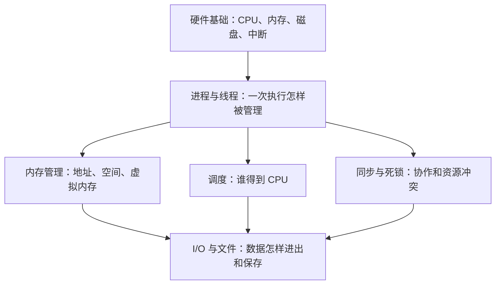

# OS-learning：把操作系统看明白

一个用于可视化学习操作系统的仓库。以 William Stallings《操作系统——精髓与设计原理》第9版为课程参考，结合计算机组成和实际电脑现象，逐步建立理解，再练习考试题。

## 先看全局

当前课堂位置：**第3章 3.2.1 两状态进程模型**。上图表示知识关系；后续顺序会跟随课堂与理解情况调整。

## 第一课怎么打开

下载本仓库后，用浏览器打开根目录的 **index.html**。GitHub 文件页面显示的是源代码，不会直接运行互动图。

三个场景可以分别查看：

1. **软件怎么跑起来**：程序文件 → 建立进程 → 准备内存 → CPU 执行。
2. **让 CPU 换个人**：执行一条指令、切换进程、保存与恢复现场、等待数据。
3. **对照真实电脑**：软件、多个进程、多个逻辑处理器之间的关系。公开版使用示例数据，不读取访问者电脑。

**试一次就能观察的现象：** 在第二个场景让 A 执行一条指令，再切到 B、切回 A。观察 A 的 PC 是否从保存的位置继续。PC 是程序计数器，这里表示下一条指令的地址。

## 每一课怎样讲

**先定位全局 → 看实际现象 → 操作图解 → 解释因果 → 对照教材 → 练一道题。**

- 默认从零开始，首次出现的术语当场解释，补上需要的计算机组成基础。
- 详细内容分层展开，每次围绕一条关键链路讲清楚，不用连续的大段文字堆叠。
- 比喻用于建立直觉，再说明对应的真实机制和比喻的边界。
- 区分“讲清楚”“带着练”“直接完成”，按当次约定推进。
- 教材定位、课堂考试范围、模拟数据和真实观察分别标明；不把推测当成考试重点。

## 当前完成到哪里

| 项目 | 状态 |
| --- | --- |
| 第一课三场景互动图 | 已验证：启动、保存与恢复、等待数据及数据到达；360px 窄屏无横向溢出 |
| 整门课程内容 | 正在逐步补充 |
| 学习者是否掌握 | 尚未判断；不以页面做完、点过按钮或上传仓库代替理解 |

判断理解时，关注能否预测图中下一步、解释原因，并独立完成相应题目。

## 模型的边界

- 两状态演示假设只有一个执行位置，每个进程只有一个线程；真实系统可以多核心并行，并按线程调度。
- 演示中的 PC 每次加1、寄存器 R 每次加1，是为了看清进度的教学约定，不是通用指令规则。
- PCB 表示进程控制块；本例把单线程执行现场关联到 PCB，真实系统的线程现场由相应的线程管理结构保存。
- 图中移动的是执行机会的标记，不表示每次切换都搬走整个程序；内存与缓存等细节在后续章节展开。
- “等待数据”用于揭示未运行态内部的差异；新建、退出和完整五状态模型尚未加入本课互动。

参考位置：教材第65—68页，3.1.2、3.2、3.2.1，图3.2—3.5。仓库发布自制图解与说明，不包含教材 PDF 或扫描页。

可编辑图解源文件位于 `lessons/process-states.fragment.html`，独立打开版本为 `index.html`；教学协作约定见 `AGENTS.md`。
